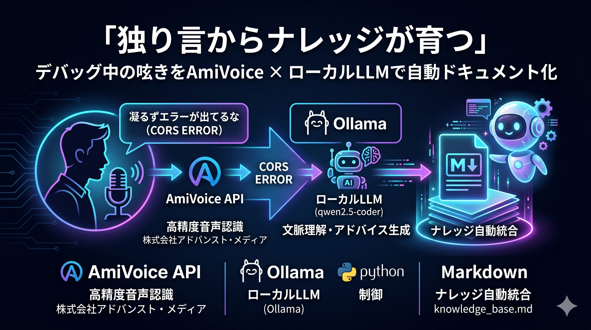

# 🎙️ Debug Assistant with AmiVoice & Ollama

開発中に遭遇したエラーやトラブルについて「独り言」をつぶやくだけで、AIシニアエンジニアから的確なデバッグアドバイスをもらい、さらにその知見を自動でナレッジベースへ統合・蓄積していくインテリジェントなデバッグアシスタントツールです。

---

## ✨ 主な機能

1. **🎤 音声録音機能**  
   マイクから直接トラブルのつぶやきを録音できます（5秒間）。マイクがない環境では、用意したサンプル音声ファイルを読み込ませることも可能です。
2. **🚀 AmiVoice ACP API による高精度音声認識**  
   音声認識 API「AmiVoice」を利用し、開発者の呟きをスピーディかつ正確に日本語テキストへ変換します。
3. **🤖 ローカルLLM (Ollama) によるデバッグアドバイス**  
   Ollama で動作するローカル大規模言語モデル（デフォルト: `qwen2.5-coder:7b`）を使い、過去のナレッジを考慮したアドバイスを生成します。日本のシニアエンジニアのような、丁寧かつ簡潔な日本語で回答します。
4. **🧹 ナレッジの自動統合・マージ (Self-Cleaning Knowledge Base)**  
   今回のトラブルとアドバイスの内容を、既存の `knowledge_base.md` に賢くマージします。類似した事象があれば重複を避けて統合し、新しい事象であれば新しい見出しを作って自動整理します。

---

## 🛠️ 技術スタック & 依存ライブラリ

- **開発言語**: Python >= 3.13
- **パッケージ管理**: `uv` (高速なPythonパッケージインストーラー)
- **主要パッケージ**:
  - `openai`: Ollama 互換 API へのアクセス用
  - `python-dotenv`: `.env` からの環境変数読み込み用
  - `requests`: AmiVoice API へのリクエスト送信
  - `sounddevice` & `scipy`: マイクからの音声録音およびファイル保存用

---

## 📋 前提条件

1. **Ollama のインストールと起動**
   ローカルLLMを動かすため、あらかじめ [Ollama](https://ollama.com/) をインストールし、必要なモデルを pull して起動しておきます。
   ```bash
   # 例: Qwen 2.5 Coder 7B モデルを pull する場合
   ollama pull qwen2.5-coder:7b
   ```
2. **AmiVoice API キーの取得**
   [AmiVoice Cloud Platform のクイックスタート](https://docs.amivoice.com/amivoice-api/manual/getting-started/#quick-start) を参考に、音声認識用の API キーを取得してください。

---

## ⚙️ セットアップ手順

### 1. 依存関係のインストール

本プロジェクトは `uv` を使用して依存関係を管理しています。以下のコマンドで仮想環境の作成とライブラリのインストールを行います。

```bash
# 仮想環境を作成し、依存ライブラリを同期
uv sync
```

*（`uv` がインストールされていない場合は、`pip install -r requirements.txt` などでも代用可能ですが、`uv` の使用を推奨します）*

### 2. 環境変数の設定

`.env.example` をコピーして `.env` ファイルを作成し、必要な設定を行います。

```bash
cp .env.example .env
```

`.env` 内の各環境変数を設定します：

```ini
# AmiVoice ACP API の API キー
AMIVOICE_API_KEY=your_amivoice_api_key_here

# 使用する Ollama の LLM モデル名
LLM_MODEL=qwen2.5-coder:7b

# マイクから直接録音するかどうか (true: 録音する, false: サンプル音声を使用する)
USE_VOICE_RECORD=false
```

---

## 🚀 使い方

1. **Ollama が起動していることを確認**します。
   ```bash
   curl http://localhost:11434/
   # "Ollama is running" と返ってくれば正常に起動しています
   ```

2. **アシスタントを起動**します。
   ```bash
   uv run main.py
   ```

3. **動作モードに応じた処理**：
   - **`USE_VOICE_RECORD=true` の場合**：
     - 起動すると `🎤 【デバッグ中...】5秒間、独り言をどうぞ！` と表示され、録音が開始されます。PCのマイクに向かってエラー内容（例：「CORSエラーが出ちゃって動かないな…」など）を喋ってください。
   - **`USE_VOICE_RECORD=false` の場合**：
     - 録音は行われず、リポジトリに配置されているサンプル音声ファイル（デフォルト: `situation_debug_api.mp3`）を読み込んでシミュレーションを行います。

4. **結果の出力と自動蓄積**：
   - AmiVoice が音声を認識し、テキスト化します。
   - ローカルLLMが、過去の `knowledge_base.md` に蓄積されたナレッジを参照しつつ、今回のトラブルに対するアドバイスを日本語で提示します。
   - 今回得られた知見が自動で整理され、`knowledge_base.md` に上書き保存（マージ）されます。

---

## 📂 ディレクトリ構成

```text
.
├── sample_voice # 音声読み上げソフト「©音読さん」にて作成したサンプル音声集
│   ├── situation_debug_api.mp3    # API関連のトラブルのサンプル音声
│   ├── situation_debug_infra.mp3  # インフラ関連のトラブルのサンプル音声
│   └── situation_debug_web.mp3    # Web関連のトラブルのサンプル音声
├── .env.example            # 環境変数のサンプルファイル
├── .env                    # 環境変数設定ファイル (git非推奨)
├── README.md               # 本ドキュメント
├── main.py                 # デバッグアシスタントのメインプログラム
├── pyproject.toml          # プロジェクト定義・依存関係
└── uv.lock                 # 依存関係のロックファイル
```

---

## 📝 ナレッジベースの成長イメージ

実行するたびに、`knowledge_base.md` は以下のように自動的に整理・成長していきます。

```markdown
# デバッグナレッジベース

## CORSエラー（クロスドメイン制限）
- **事象**: ブラウザのコンソールにCORSエラーやプリフライトリクエストの失敗（405など）が出る。
- **原因・対策**: フロントとバックエンドのドメインミスマッチ、またはHTTPメソッドの定義不一致。FastAPI等ではCORSMiddlewareのallow_originsの末尾スラッシュの有無を確認してください。また、カスタムヘッダーを送る場合はallow_headersへ追加してください。

## HTTPメソッドのエラー
- **事象**: 画面に405 Error (Method Not Allowed) が出る。
- **原因・対策**: APIリクエストのHTTPメソッドと、サーバー側で定義されているメソッドの不一致。フロントエンドのfetchリクエスト等のメソッド指定が正しいか再確認してください。
```
